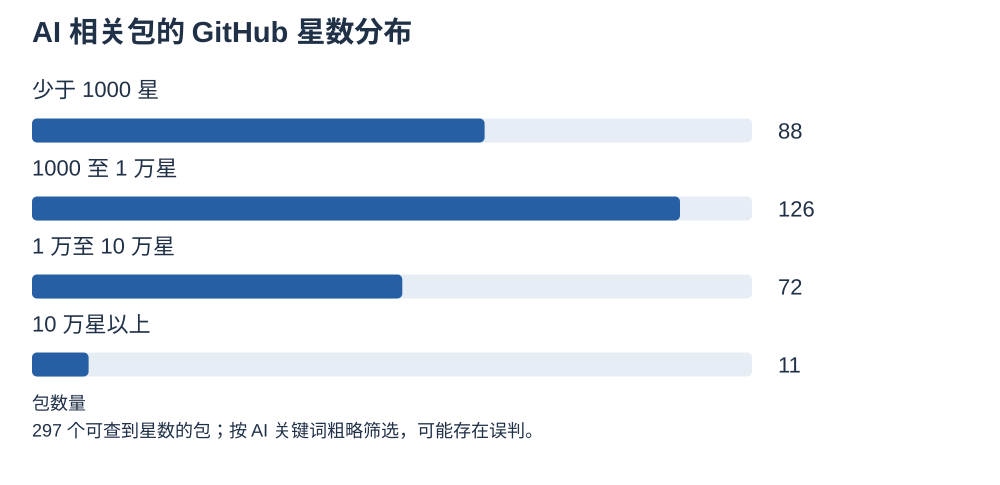
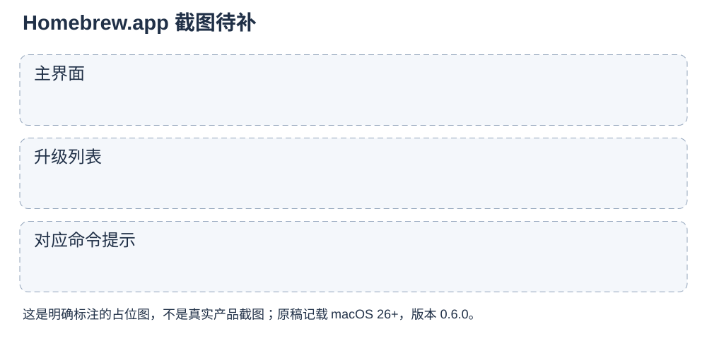

文中数据截至 2026 年 11 月 9 日

前阵子你是不是跟着教程装了一堆 AI 工具？Claude Code、Ollama、Gemini CLI，一口气都上了。

三个工具，三种装法。有的用 npm 装，有的粘贴一行 curl 脚本，还有的去官网下载 dmg 安装包。

npm 是程序员常用的软件仓库工具，curl 脚本就是从网上下一段脚本直接运行，dmg 则是 Mac 上常见的安装镜像文件。这三种方式各管各的，彼此不通气。

装好没多久，每个工具都提示“有新版本”。你不知道该去哪里升级，升完一个，另一个又出了问题。这不是你笨，是这种各装各的做法本来就难维护。

AI 工具一周一个版本，追新是个无底洞。与其一个个手动追，不如交给一个统一的入口去管，这个入口就是 Homebrew。

你可能会觉得，不就是升级吗，点一下不就好了。问题在于，每个工具都有自己的一套更新方式，有的要重新运行安装脚本，有的要重新下载安装包，还有的要去翻它的更新说明。工具一多，光是记住“我到底装了什么、该怎么升”，就已经占掉了大半精力。

这就像家里同时用着七八个遥控器，每个遥控器的电池、按键和换台方式都不一样。你想看个电视，得先找对遥控器，还得想起它的用法。统一入口的意思，就是把这些遥控器换成一个万能遥控，剩下的事情交给它。


## Homebrew 到底是什么

先解释两个词。终端是 Mac 上那个黑底白字的窗口，很多 AI 工具都在里面运行。包管理器则是一个替你统一下载、安装、升级、卸载软件的管家。

Homebrew 可以理解成 Mac 上的“命令行版 App Store”。它的官方口号是 The Missing Package Manager for macOS，意思是“macOS 缺失的包管理器”。

App Store 管的是图形界面的 App，Homebrew 主要管命令行工具，像 AI 编程助手、本地模型这类在终端里跑的程序。普通的图形 App 它也能装，只是要多加一个参数。

这就像家里的快递驿站。东西不管从哪家寄来，都在一个地方签收、查看、退换，你不用记每家快递的规矩。

## 它是怎么来的

Homebrew 2009 年由英国开发者 Max Howell 发起。【待核实】他当时觉得 MacPorts、Fink 这些同类工具太难用，于是自己动手写了一个。

名字和术语都来自自酿啤酒：formula 是配方，bottle 是瓶装，cask 是酒桶，tap 是酒头。你后面会碰到 cask 这个词，它指的就是图形 App 那一类。

Homebrew 很快成了 Mac 开发者的事实标准。几乎每个开源工具的说明文档里，macOS 那一栏写的第一种安装方式都是用 Homebrew。很多开发者拿到新 Mac 的第一件事，就是先把它装上。

2015 年，作者去 Google 面试，因为没能在白板上写出“翻转二叉树”被拒。【待核实】他随后发了一条很有名的推文：“Google 90% 的工程师都在用你写的软件……”【待核实】这件事从侧面说明了它有多普及。

Homebrew 也一路跟上了 Mac 的变化，它用 Cask 收编了图形应用，2021 年开始原生支持 Apple Silicon（苹果自研的芯片）。【待核实】2026 年，它又推出了官方图形界面，后面会专门讲这个。

Homebrew 是由志愿者维护的开源项目，靠社区捐助运营。它在 AI 浪潮之前就已经是 Mac 开发者的基础设施，AI 只是把一批新用户带到了它面前。所以它是一个经过很多年检验的入口，适合放心交给它。

## 为什么说追新不如交给它

这一章是全文的重点。道理很简单：AI 工具一周一个版本，各家的装法还不一样，新手既记不住，也查不清。

**一条命令全部升级。**Homebrew 装过的工具，都可以用一条命令统一升级：

```sh
brew upgrade
```

这就像手机里的应用更新，不用一个个点进去，一键全部搞定。它是全文最重要的一条，记住它，追新就不用再靠记忆。

更关键的是，这条命令不挑工具。你装在 Homebrew 里的 AI 编程助手、本地模型、命令行小工具，都会被一起检查、一起升级。你不需要知道每个工具的更新网址，也不用在十几个窗口之间来回切换，只需要在终端里敲一次。

很多人会问：Homebrew 上的版本更新得快不快？我们统计了 9 个主流 AI 工具最近 90 天的 222 次版本更新，统计区间是 2026 年 8 月 11 日到 11 月 9 日。

结果是，70% 的更新在官方发布后 6 小时内上架 Homebrew，87% 在 24 小时内上架。下面这张图和表是每个工具的具体情况，“中位时差”是把所有版本的等待时间排好队后取中间那个，比平均值更不容易被个别极端情况拉偏。


| 工具 | 中位时差 | 6 小时内上架 | 24 小时内上架 | 最慢一次 |
| --- | --- | --- | --- | --- |
| Codex | 1.8 小时 | 34 / 34 | 34 / 34 | 3.4 小时 |
| uv | 1.6 小时 | 27 / 28 | 28 / 28 | 17.1 小时 |
| llama.cpp（正式版） | 1.6 小时 | 3 / 3 | 3 / 3 | 2.8 小时 |
| Claude Code（@latest） | 3.5 小时 | 67 / 76 | 76 / 76 | 17.9 小时 |
| OpenCode | 0.5 小时 | 6 / 8 | 7 / 8 | 270 小时 |
| Hermes Agent | 6.7 小时 | 7 / 16 | 12 / 16 | 311 小时 |
| OpenClaw | 8.0 小时 | 8 / 20 | 20 / 20 | 22.9 小时 |
| Ollama | 25.0 小时 | 4 / 33 | 14 / 33 | 281 小时 |
| Gemini CLI | 26.8 小时 | 0 / 4 | 0 / 4 | 128 小时 |
| 合计 | — | 156 / 222（70%） | 194 / 222（87%） | — |

表格里的分母，是能和官方发布记录对上的版本数。llama.cpp 和 OpenCode 有一部分更新对不上官方记录，没有计入统计。

Codex、uv、llama.cpp 的中位数都不到 2 小时，Claude Code 约 3.5 小时。OpenCode 有时甚至比 GitHub 发布页还早，一共 3 次，这种情况记为 0。Ollama 和 Gemini CLI 的中位数在 1 天左右，属于慢的一档。

个别版本拖得更久，最慢的一次接近两周，表格最后一列写得很清楚。Gemini CLI 也有掉队的时候。从 9 月中旬到 10 月 19 日，Homebrew 里的版本一直停在 0.46.0，同期官方已经发布到 0.63.0，10 月 19 日才一次跳到 0.64.0。这段停滞不算在上面的时差里。

还有一种情况不算滞后：一天发好几版的工具，Homebrew 会直接跳到最新版，中间的版本不会一个个上架。

对新手来说，晚几个小时到一天，换来的是不用自己盯着更新。真要抢首发，再去官方渠道装就行。所以准确的说法是：多数几小时内上架，慢的一天左右。

顺便提一个小知识：Claude Code 有两个版本可选，`claude-code` 跟随官方稳定版，`claude-code@latest` 跟随最新版。想稳一点选前者，想尝鲜就选后者。

除了省心追新，Homebrew 还有几个好处。

**不用先学环境配置。**很多 AI 工具背后要 Python、Node 之类的运行环境。你不必先搞懂这些，装上就能用。

**装了什么一目了然。**装过的东西都有记录，哪天不想用了，卸载就行。模型文件是例外，后面会讲。

**比网上随便复制的脚本更让人放心。**Homebrew 上的每个包都经过公开审核，下载的文件还有校验。

**换新电脑也好办。**把装过的东西整理成一份清单，换新 Mac 时可以一次装回来，延伸阅读里有做法。

AI 工具会一直这么快地迭代下去。与其每个都手动追，不如让 Homebrew 替你盯着。

## 新手只记五条命令

Homebrew 的命令很多，但新手日常真正用得上的，只有下面这几条。

第一步是装 Homebrew 本身。去 Homebrew 官网（brew.sh）复制那一行安装命令，粘贴到终端里回车就行。网络慢的话，可以换成国内镜像，延伸阅读里有名字可以搜。

装好之后，记住下面这五种写法：

```sh
brew install 名字
brew install --cask 名字
brew upgrade
brew list
brew uninstall 名字
```

第一条用来装命令行工具，比如一个 AI 编程助手。第二条多了 `--cask`，专门用来装带窗口的图形 App。

第三条是 upgrade，也就是升级，这是全文最重要的一条，前面讲的追新就靠它。第四条 list 用来查看你都装了什么，像翻一下家里的物品清单。第五条 uninstall 用来卸载，不想要的东西就让它离开。

这五条记熟，AI 工具再怎么更新，你只需要想起 upgrade 那一条。其他命令先不用管，进阶内容放在文末。

日常的节奏也很简单。装好之后，隔一段时间想起来，就在终端里敲一次 upgrade，顺便用 list 看看装了哪些东西。不用每天盯着，也不用每个版本都去看说明，这就是“省心追新”的全部秘诀。

如果哪天某个工具用不上了，就用 uninstall 把它请出去。Homebrew 的好处之一，就是装和卸都走同一套规矩，不会留下一堆来路不明的残留。

## 你听说过的 AI 工具，Homebrew 基本都有

GitHub 上的 star 可以理解成“点赞收藏”。star 超过 10 万的项目共 141 个，我们从中挑出 AI 相关的，逐个去 Homebrew 里查，数据截至 2026 年 11 月 9 日。

结论很直接：Agent 和本地模型 100%，装了就能用的 AI 软件 74%。

对新手来说，这个数字的意义在于：你在教程里看到的那些热门名字，大多数都能从同一个地方装。你不必为每个工具单独找安装页面，也不必担心选错渠道。先去 Homebrew 查一下，多半就能找到答案，找不到的少数情况，再按下面的分类去处理。

Agent 指能替你动手干活的 AI 程序，这一类有 8 个，OpenClaw、DeepSeek Harness、Hermes Agent、OpenCode、Claude Code、Codex、Gemini CLI、Pi 全都在 Homebrew 官方仓库里。本地模型类有 Ollama、llama.cpp、Whisper 三个，同样全部在官方仓库。

分类是人工判断的。像 claw-code 这类被归为实验项目的，就没有计入这 8 个。


这里的“装了就能用”，指下载装上就能直接用的软件，不包括需要写代码才能调用的库。这 23 个里，17 个能用 Homebrew 装。其中 15 个在官方仓库，2 个在项目自家的 tap（可以理解成作者自己开的小仓库）。

Homebrew 覆盖的范围比你想象的还广。桌面版和工具方面，有 cc-switch、ComfyUI 桌面版、Open WebUI 桌面版、Open Design、LM Studio、Claude、ChatGPT。

框架方面，PyTorch 有官方收录，Hugging Face 有 hf 命令行，LangChain 有 langgraph-cli。这里的收录，指的是 Homebrew 官方仓库里有一份可以直接安装的“配方”（formula）。

环境方面有 uv、python、node。其中 uv 是管理 Python 环境的工具，过去 30 天被安装了 206,718 次。

新的小项目也不少。和 AI 相关的包约 300 个，其中 88 个在 GitHub 上不到 1000 星。



比如 splitrail（228 星）能实时监控 AI 编程助手的 token 用量和花费，token 可以粗略理解成 AI 计费的计量单位。claude-hooks（397 星）是 Claude Code 的 hook 管理工具，hook 可以理解成在某个时机自动触发的小机关。happy-coder（551 星）则能用手机操作电脑上的 AI 编程助手。

热度也能说明问题。过去 30 天的安装次数里，Codex 有 351,138 次，Ollama 有 62,453 次（另有 App 版 8,975 次），Claude Code 有 58,378 次，OpenCode 有 45,393 次，llama.cpp 有 35,373 次。这是 Homebrew 公开统计的数字，只计算开启了统计的用户，实际会更高。


也有一些热门项目不在 Homebrew 里，搜不到时别以为自己搞错了。它们大致分四类：

- 平台类，比如 n8n、Dify、AutoGPT，一般用 Docker 部署。Docker 可以理解成把软件连同运行环境打包好的“集装箱”，新手可以先用它们的官方云服务。

  - 开发库和框架，比如 Transformers、LangChain、browser-use。它们是写代码时调用的库，应该按项目的说明，用 pip 或 uv 装进具体的项目里。pip 是 Python 自带的安装工具。

  - Python 脚本类，比如 Stable Diffusion WebUI、MoneyPrinterTurbo，按项目说明装即可。想画图的新手，可以直接装 ComfyUI 桌面版，省事很多。

  - 内容类，比如 skills、提示词合集、教程、模型权重。它们本身就不是软件，谈不上“安装”。

所以不用记住所有名字，记住“先去 Homebrew 查一下”就够了。搜不到的，就按上面的类别去找正确的装法。

## 不想碰终端？先试官方 App

如果你连终端都不想碰，Homebrew 也有适合你的入口。在 Homebrew 7.0（2026 年 9 月）里，它推出了官方图形界面，对新手最友好。

点按钮就能完成安装和升级，同时还会显示对应的命令，你可以边用边学。装法同样只有一行：

```sh
brew install --cask homebrew-app
```

装好后会得到一个叫 Homebrew.app 的应用。它的源码仓库叫 Homebrew/BrewUI，所以网上也有人叫它 BrewUI。



用之前有三点心里要有数：当前版本是 0.6.0，还没到 1.0；需要 macOS 26 及以上；过去 30 天安装了 5,251 次。

把升级也做成按钮，等于把追新这件事放进了一个看得见的界面。你随时点一下，就能看到哪个工具该更新了。

这有点像汽车的仪表盘。你不用懂发动机的每一个零件，只要看一眼指示灯，就知道该不该去保养。对于还没打算深入终端的新手，这种“看得见”的方式，反而更容易坚持下来。

## 第三方 App 怎么选

除了官方 App，社区里还有几款第三方图形界面，各有所长。

- **Applite**：免费，界面像应用商店，只管图形应用，最适合纯新手。【待核实】

  - **Cork**：功能最全，但需要付费。【待核实】

  - **Bold Brew**：在终端里使用的界面，它本身也是通过 Homebrew 安装的，适合想慢慢学终端的人。

  - **Cakebrew 等老工具**：已经停更，不推荐。【待核实】

选择可以很简单。系统是 macOS 26，直接用官方 App；系统较老、只想装软件，用 Applite；想管得更细，用 Cork。


无论选哪个，它们管的还是同一个 Homebrew，你学会的命令在哪儿都能用。

选 App 有点像去超市买菜。有的超市门口一眼能看到全部分类，适合逛一圈就买；有的超市货架分得细，适合每次都知道自己要什么的人。两家超市的收银台是同一套，你换着逛都不吃亏。

这也正是前面说的那个立意：入口可以换，追新的活儿始终交给同一个管家。

## 几个小提醒

**同一个工具只用一种方式装。**别先用 Homebrew 装一遍，又照着另一篇教程用 npm 再装一遍。两套并存时，你很难分清自己到底在用哪一个。这就像家里有两把钥匙开同一把锁，时间一长，你就不记得哪把是新配的了。

**想第一时间用上新功能，可以走官方渠道。**它通常会比 Homebrew 早几个小时，慢的时候早一天左右，偶尔的抢先体验值得这么做。只是这样做之后，那个工具就要换成官方那条线去维护，别再混着用。

**模型文件很大，不归 Homebrew 管。**卸载工具后，记得手动清理这些模型文件，否则硬盘会悄悄变满。Homebrew 管的是程序本身，模型文件像是搬进来的行李，要自己负责收拾。

## 结尾

AI 工具会一直这么快地更新下去。与其每个都手动追，不如把追新交给 Homebrew，把精力留给真正用 AI 做事。

回头想想，你最初的困扰并不是技术不够，而是要记的东西太多。把“怎么装、怎么升、怎么卸”这些重复的事情统一起来，脑子里就能腾出空间，去想今天要用 AI 解决什么问题。这才是工具存在的意义。

如果你读完这篇，只记住一件事，那就是 upgrade。之后每次看到 AI 工具又发新版本，别急着去翻说明书，想一想，它大概率已经在 Homebrew 里等着你了。

你现在用 Homebrew 管了哪些 AI 工具？欢迎在评论区告诉我，我们一起看看还有没有漏掉的好工具。

## 延伸阅读

- 常用命令速查：search、info、outdated、pin、cleanup、doctor、services

  - 国内镜像配置：清华 TUNA、中科大 USTC

  - 用 Brewfile 备份和迁移整套工具

## 参考资料

- [Homebrew 7.0.0 发布说明](https://brew.sh/2026/09/13/homebrew-7.0.0/)

  - [Homebrew 5.0.0 发布说明](https://brew.sh/2025/11/12/homebrew-5.0.0)

  - [BrewUI 安装指南（Mac Install Guide）](https://mac.install.guide/homebrew/brewui)

  - [MPU Talk：Homebrew 官方 macOS App 讨论](https://talk.macpowerusers.com/t/homebrew-now-has-its-own-native-macos-app/46925)

  - [Setapp：Homebrew 图形界面工具推荐](https://setapp.com/tech-talks/best-homebrew-gui-for-mac)

  - [Homebrew 维基百科词条](https://en.wikipedia.org/wiki/Homebrew_(package_manager))
